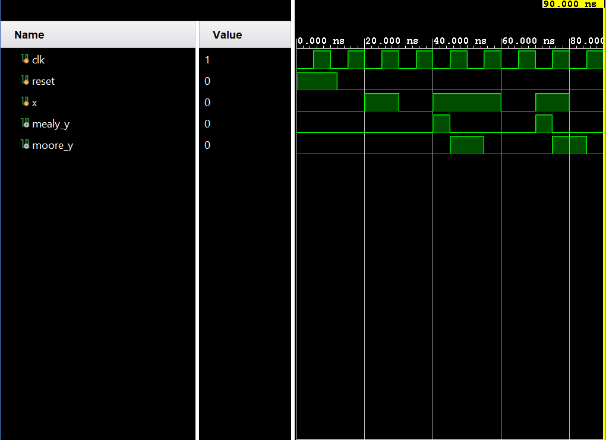

# FPGA Digital Logic & State Machine Design

## Project Overview
Designed and simulated Mealy and Moore finite state machines using Verilog HDL and Xilinx Vivado. Both designs implement a sequence detector that identifies the binary pattern `101`, including overlapping occurrences.

## Design Implementation

### Mealy Finite State Machine
- Implemented a three-state sequence detector using Verilog HDL.
- Generated an output based on the current state and input.
- Used sequential and combinational logic to detect the `101` pattern.

### Moore Finite State Machine
- Implemented a four-state sequence detector using Verilog HDL.
- Generated an output based exclusively on the current state.
- Compared the output timing of Moore and Mealy implementations.

## Simulation and Verification
- Developed a Verilog testbench to simulate both state machines.
- Applied the input sequence `101101` to test overlapping pattern detection.
- Observed output signals and state-machine behavior using Vivado's behavioral simulation.
- Compared Mealy and Moore output timing.

### Simulation Waveform

## Hardware Configuration
- Target board: Digilent Nexys A7-100T
- FPGA: Xilinx Artix-7
- Clock: 100 MHz onboard oscillator
- Reset: SW0
- Input: SW1
- Output: LED0

The project includes an XDC constraint file for future FPGA implementation. Verification documented here was performed through behavioral simulation.

## Tools and Technologies
- Verilog HDL
- Xilinx Vivado
- Digilent Nexys A7
- Behavioral simulation
- Finite state machine design

## Project Files
- `mealy_fsm.v` — Mealy FSM implementation
- `moore_fsm.v` — Moore FSM implementation
- `fsm_tb.v` — Verilog simulation testbench
- `fsm_constraints.xdc` — Nexys A7 pin constraints
- `fsm-simulation.png` — Simulation waveform

## Future Improvements
- Implement and test both FSMs on the physical Nexys A7 board.
- Compare synthesis resource utilization.
- Expand verification with additional test sequences.
